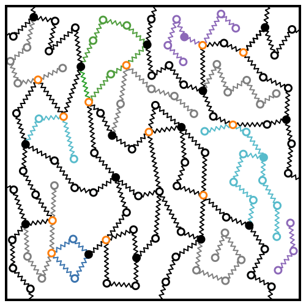
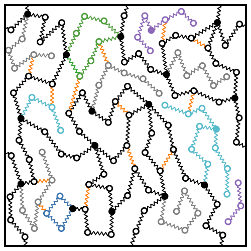
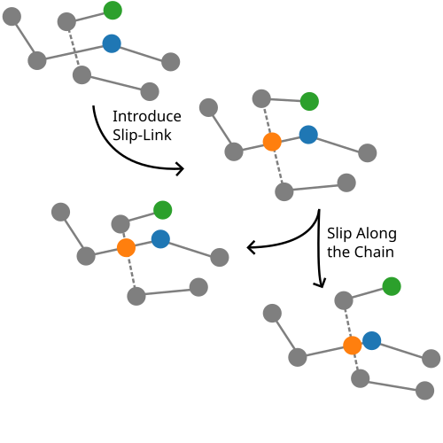

# Nomenclature

This section defines key terms used throughout pylimer-tools documentation and the library itself.
Understanding these terms is crucial for effective use of the library.

## Core Entities

**Atom**
: An [`Atom`](api/pylimer_tools_cpp.Atom.md#pylimer_tools_cpp.Atom) represents a fundamental unit in the simulation, used interchangeably with “bead” following LAMMPS conventions.
  Each atom has properties such as position, type, and mass.
  Following LAMMPS convention, each atom must have a unique ID, a type and a position.

**Molecule**
: A [`Molecule`](api/pylimer_tools_cpp.Molecule.md#pylimer_tools_cpp.Molecule) is a collection of atoms that are necessarily connected through bonds. This could represent a polymer chain, a strand, or even a single atom depending on the system.

**Universe**
: A [`Universe`](api/pylimer_tools_cpp.Universe.md#pylimer_tools_cpp.Universe) represents a complete collection of atoms in a simulation system. Atoms within a universe are not necessarily all connected to each other.

**UniverseSequence**
: A collection of universes, typically representing different time steps or configurations of the same system.

## Graph Theory Terms

**Vertex**
: In the internal graph representation, a vertex corresponds to a bead/atom/particle. The graph uses its own numbering scheme for vertices, which may differ from atom IDs.

**Edge**
: An edge in the graph represents the connectivity between two vertices (atoms). Note the distinction between “edge” and “bond”:
   
  - **Edge**: Uses the graph’s internal numbering scheme
  - **Bond**: Uses the atom ID numbering scheme from the simulation
   
  Methods referring to edges require the graph’s numbering, while methods referring to bonds use atom IDs.

## Polymer-Specific Terms

**Junction/Crosslink(er)**
: Used interchangeably to describe beads that connect different strands or molecules in a polymer network.
  These are critical for decomposing network topology.

**Strand/Chain**
: A linear sequence of connected atoms, typically between junction points or chain ends.
  As a part of the network, it is referred to as a “strand”, while in isolation, it is called a “chain”.

**Network**
: A collection of polymer strands connected by crosslinks, possibly also involving free chains and crosslinks.

**Radius of Gyration**
: A measure of the spatial extent of a polymer chain, calculated as the root-mean-square distance from the center of mass.

**End-to-End Distance**
: The Euclidean distance between the two terminal atoms of a linear polymer chain.

## Entanglement & Force Balance Terms

**Entanglement Link**
: A topological entanglement represented as a single merged 4-functional junction node pinning two chains (Bernhard and Gusev [[BG25](acknowledgements.md#id12)]), selected via [`MERGED_LINKS`](api/pylimer_tools_cpp.EntanglementMode.md#pylimer_tools_cpp.EntanglementMode.MERGED_LINKS) in [`MEHPNetwork`](api/pylimer_tools_cpp.MEHPNetwork.md#pylimer_tools_cpp.MEHPNetwork) and [`MEHPSimulator`](api/pylimer_tools_cpp.MEHPSimulator.md#pylimer_tools_cpp.MEHPSimulator).
  With [`LinearSystemMEHPSolver`](api/pylimer_tools_cpp.LinearSystemMEHPSolver.md#pylimer_tools_cpp.LinearSystemMEHPSolver), [`NonlinearOptimizationSolver`](api/pylimer_tools_cpp.NonlinearOptimizationSolver.md#pylimer_tools_cpp.NonlinearOptimizationSolver), or [`FIXED`](api/pylimer_tools_cpp.SlipMode.md#pylimer_tools_cpp.SlipMode.FIXED), its contour position is fixed—it does not slip along the chain contour.

**Entanglement Spring**
: A representation where entangled chains remain separate and are coupled by a compliant Hookean spring ([`SPRING`](api/pylimer_tools_cpp.EntanglementMode.md#pylimer_tools_cpp.EntanglementMode.SPRING) in [`MEHPNetwork`](api/pylimer_tools_cpp.MEHPNetwork.md#pylimer_tools_cpp.MEHPNetwork) and [`MEHPSimulator`](api/pylimer_tools_cpp.MEHPSimulator.md#pylimer_tools_cpp.MEHPSimulator)). Like fixed entanglement links, it does not slip along the chain contour.

**Slip-Link / Slip-Spring**
: An entanglement link that is permitted to slide dynamically along the polymer chain contour to equalize strand tensions.
  Supported in [`MEHPSimulator`](api/pylimer_tools_cpp.MEHPSimulator.md#pylimer_tools_cpp.MEHPSimulator) via [`SlipLinkRelaxationSolver`](api/pylimer_tools_cpp.SlipLinkRelaxationSolver.md#pylimer_tools_cpp.SlipLinkRelaxationSolver) ([`MEHPSlipLinkSolverConfig`](api/pylimer_tools_cpp.MEHPSlipLinkSolverConfig.md#pylimer_tools_cpp.MEHPSlipLinkSolverConfig) with [`SLIDING`](api/pylimer_tools_cpp.SlipMode.md#pylimer_tools_cpp.SlipMode.SLIDING)), whereas [`LinearSystemMEHPSolver`](api/pylimer_tools_cpp.LinearSystemMEHPSolver.md#pylimer_tools_cpp.LinearSystemMEHPSolver) and [`NonlinearOptimizationSolver`](api/pylimer_tools_cpp.NonlinearOptimizationSolver.md#pylimer_tools_cpp.NonlinearOptimizationSolver) use fixed links ([`FIXED`](api/pylimer_tools_cpp.SlipMode.md#pylimer_tools_cpp.SlipMode.FIXED)) because slipping was found to be an unnecessary complication that artificially softens the plateau modulus (Bernhard and Gusev [[BG25](acknowledgements.md#id12)]).

**Spring vs. Strand**
: In the canonical MEHP network ([`MEHPNetwork`](api/pylimer_tools_cpp.MEHPNetwork.md#pylimer_tools_cpp.MEHPNetwork)), a **strand** is the full chain connecting two chemical crosslinks (or an entanglement coupling strand in spring mode), while a **spring** (or partial spring) is an individual constitutive connection between two adjacent links (crosslinks or entanglement links).

## Mass vs. Weight Terminology

#### NOTE
**Mass vs. Weight**: We generally try to follow official scientific nomenclature.
However, there are historical inconsistencies where we follow tradition and use “weight” instead of “mass” in certain function names:

- [`compute_number_average_molecular_weight()`](api/pylimer_tools_cpp.Universe.md#pylimer_tools_cpp.Universe.compute_number_average_molecular_weight)
- [`compute_weight_average_molecular_weight()`](api/pylimer_tools_cpp.Universe.md#pylimer_tools_cpp.Universe.compute_weight_average_molecular_weight)
- [`compute_weight_fractions()`](api/pylimer_tools_cpp.Universe.md#pylimer_tools_cpp.Universe.compute_weight_fractions)

These functions actually calculate molecular masses, not weights. See [Mass vs. Weight](https://en.wikipedia.org/wiki/Mass_versus_weight) for the scientific distinction.

## File Format Terms

**LAMMPS Data File**
: A file format used by LAMMPS to store initial system configurations, including atom positions, bonds, angles, and dihedrals.

**LAMMPS Dump File**
: A file format used by LAMMPS to store trajectory data, typically containing time series of atom positions and properties.

**Trajectory**
: A sequence of configurations (universes) representing the time evolution of a molecular system.
  Such a trajectory could be found stored in a LAMMPS dump file.

# Conventions

## Naming Conventions

**Python Code (PEP 8)**
: - Function names: `lowercase_with_underscores`
  - Class names: `CapitalizedWords`
  - Constants: `ALL_CAPS_WITH_UNDERSCORES`

**C++ Code**
: - Function names: `camelCase`
  - Variable names: `camelCase`
  - Class names: `CapitalizedWords`

**Function Patterns**
: - Configuration functions: `config_...()` - can be called with empty arguments to reset to defaults
  - Query functions: `get_..._by_...` - retrieve subsets based on properties
  - Computation functions: `compute_...` - perform calculations and return results

## Parameter Conventions

**Default Values**
: Configuration parameters can be reset to default values by calling the corresponding `config_...()` function with no arguments.

**Index Conventions**
: - Atom indices: Based on LAMMPS atom IDs (typically 1-based, but can be arbitrary integers, not necessarily contiguous)
  - Array indices: Python-style 0-based indexing for internal arrays
  - Graph indices: Internal graph numbering (may differ from atom IDs)
